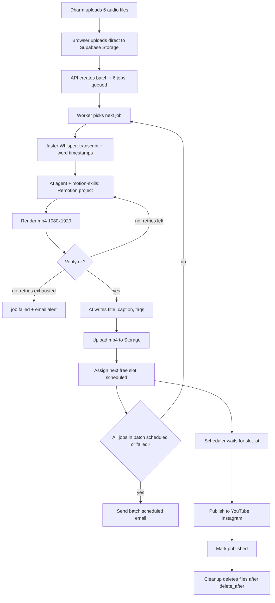
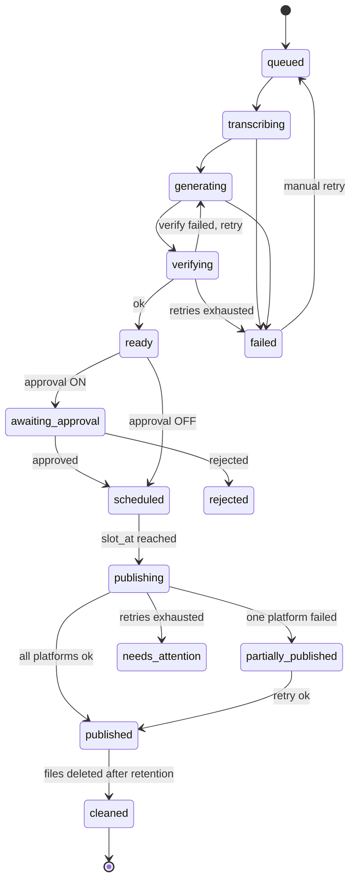
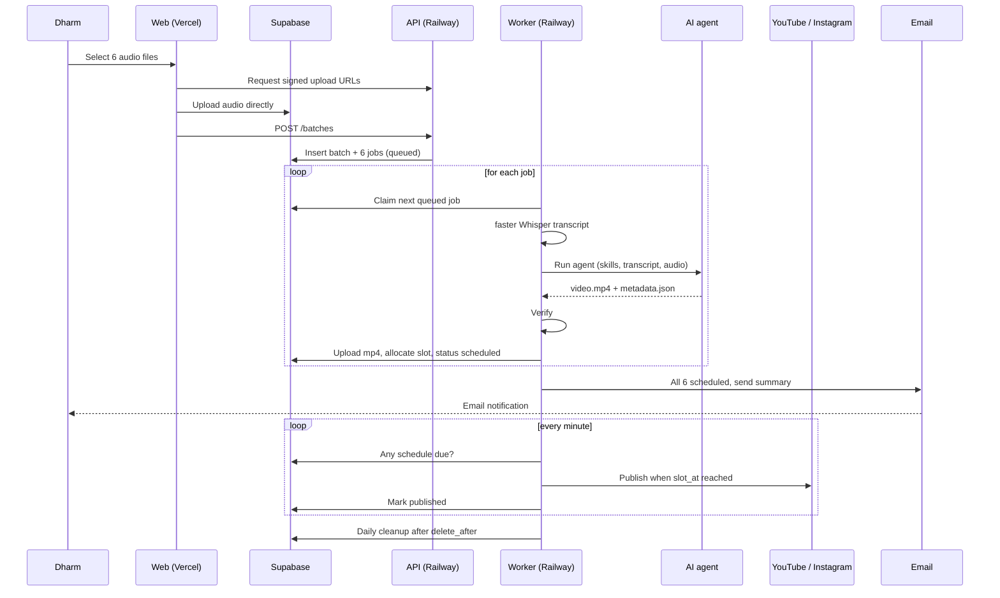

# Flow: Motion Reels Autopilot

End-to-end flow, state machine, scheduling, publishing, cleanup aur failure handling. Details ke liye `PRD.md` dekho.

---

## 1. High-level flow



## 2. Step-by-step

### Step 1: Upload
1. Dashboard par audio files select karo (mp3 / wav / m4a).
2. Web app API se signed upload URLs leta hai, browser **seedha Supabase Storage** par upload karta hai.
3. Upload complete hone par API call: `POST /batches` with file paths.
4. API ek `batch` aur har file ke liye `job` (status `queued`) banata hai.

### Step 2: Queue pickup
Worker ek atomic query se job claim karta hai, taaki do workers same job na utha sakein:

```sql
UPDATE jobs SET status = 'transcribing', started_at = now(), attempts = attempts + 1
WHERE id = (
  SELECT id FROM jobs
  WHERE status = 'queued'
  ORDER BY created_at
  FOR UPDATE SKIP LOCKED
  LIMIT 1
)
RETURNING *;
```

Concurrency = 1 (ek time par ek render).

### Step 3: Transcription
- Audio Storage se download, faster Whisper API se transcript + word-level timestamps.
- `jobs.transcript` me save, status `generating`.

### Step 4: Agent generates video
1. Worker fresh job directory banata hai: audio, transcript, style config, `remotion-base` ki copy.
2. Agent headless chalta hai (timeout 20 min). Installed skills (tiktok / kinetic typography / b-roll / explainer) use karke:
   - hook + storyboard decide karta hai,
   - Remotion composition likhta hai (words ke saath synced text + motion graphics),
   - `out/video.mp4` render karta hai,
   - khud ek frame / contact sheet check karke fix karta hai,
   - `out/metadata.json` likhta hai.
3. Status `rendering` (render phase) -> `verifying`.

### Step 5: Verify
Worker independently check karta hai:
- ffprobe: 1080x1920, H.264 + AAC, audio present
- duration = audio duration +/- 0.5s, <= max length
- metadata JSON valid, platform limits ke andar (title <= 100, caption <= 2200, tags <= 500 chars, hashtags <= 30)

Fail hua to attempts check: `< 3` to status wapas `queued` (error message agent ko feedback me), warna `failed`.

### Step 6: Save output
- mp4 Supabase Storage `video/` bucket me upload.
- `jobs.video_path`, `jobs.metadata` save, status `ready`.
- Agar approval toggle ON hai to status `awaiting_approval`, approve hone par aage badhta hai.

### Step 7: Scheduling
Job `ready` hote hi slot allocator chalta hai (section 5). Output: `schedule` row with `slot_at`, `scheduled_at = now()`, `delete_after = scheduled_at + 7 days`. Job status `scheduled`.

### Step 8: Batch complete email
Har job ke `scheduled` / `failed` hone par check:

```text
if batch.notified_at is null
   and no job in batch has status in (queued, transcribing, generating, rendering, verifying, awaiting_approval, ready)
then send summary email, set batch.notified_at = now()
```

Email me: har video ka title, platform, scheduled date/time (IST), aur agar koi fail hua to uska reason.

### Step 9: Publish at slot time
Scheduler har minute `schedule WHERE slot_at <= now() AND status = 'pending'` check karta hai (details section 6).

### Step 10: Cleanup
Daily job (section 7).

---

## 3. Job state machine



## 4. Sequence: one batch of 6



---

## 5. Slot allocation algorithm

```python
SLOTS = ["09:00", "19:00"]       # settings, IST
BUFFER = timedelta(minutes=30)

def next_free_slot(now):
    candidate_day = today(IST)
    while True:
        for t in SLOTS:
            slot_at = combine(candidate_day, t, tz="Asia/Kolkata")
            if slot_at >= now + BUFFER and not slot_taken(slot_at):
                return slot_at
        candidate_day += 1 day
```

- `schedule.slot_at` par **unique constraint**, taaki race condition me bhi double-booking na ho (conflict par next slot try karo).
- Videos jis order me `ready` hote hain usi order me slots milte hain.

**Example (6 videos, batch upload kiya Day 0 raat ko, slots 09:00 / 19:00):**

| Video | Slot |
|-------|------|
| 1 | Day 1, 09:00 |
| 2 | Day 1, 19:00 |
| 3 | Day 2, 09:00 |
| 4 | Day 2, 19:00 |
| 5 | Day 3, 09:00 |
| 6 | Day 3, 19:00 |

Agar batch din me upload ho aur pehle video ready hone par 09:00 nikal chuka ho, to pehla video usi din 19:00 le lega aur baaki aage khisak jayenge.

---

## 6. Publishing flow

Scheduler loop (har minute):

```text
due = SELECT * FROM schedule WHERE status = 'pending' AND slot_at <= now()
for each due item:
    mark schedule.status = 'publishing'
    run YouTube and Instagram publish independently
```

### YouTube
1. Access token valid hai? Nahi to refresh token se naya lo.
2. Storage se mp4 stream karke `videos.insert` (resumable upload), `privacyStatus = public`, title / description / tags metadata se, `#Shorts` description me.
3. `external_id` (video id) aur URL `publications` me save.

### Instagram
1. Storage se signed URL banao (1-2 hr expiry).
2. `POST /{ig-user-id}/media` with `media_type=REELS`, `video_url`, `caption`.
3. Container `status_code` poll karo (`IN_PROGRESS` -> `FINISHED`), timeout ~10 min.
4. `POST /{ig-user-id}/media_publish` with `creation_id`.
5. Media id / permalink `publications` me save.

### Result handling
| Outcome | Action |
|---------|--------|
| Dono platform ok | `published` |
| Ek fail, dusra ok | `partially_published`, failed platform ka retry (5 min, 15 min, 1 hr), phir email |
| Dono fail | retries, phir `needs_attention` + email |
| Worker down tha, slot nikal gaya | Worker wapas aate hi publish, agar delay <= 6 hrs; warna `needs_attention` |

---

## 7. Cleanup flow (7-day retention)

Daily (jaise 03:00 IST):

```text
candidates = SELECT jobs JOIN schedule
             WHERE schedule.delete_after <= now()
               AND video_path IS NOT NULL
for each candidate:
    if all publications for job are 'published':
        delete video file + source audio from Storage
        set video_path = NULL, audio_path = NULL, status = 'cleaned'
    else:
        skip (defer), flag in dashboard if overdue by > 3 days
```

DB record (title, links, timestamps) rehta hai, sirf files delete hoti hain.

---

## 8. Account connection and token upkeep

```mermaid
flowchart LR
    A[Click Connect YouTube / Instagram] --> B[Redirect to Google / Meta consent]
    B --> C[Callback on Railway API with code + state]
    C --> D[Exchange code for tokens]
    D --> E[Encrypt + store in social_accounts]
    E --> F[Dashboard shows connected]
    F --> G[Daily token check]
    G -->|expires in under 10 days| H[Refresh token]
    H -->|fails| I[Email: reconnect needed]
```



- **Google:** refresh token se access token auto-renew; consent screen ko Production me rakho taaki refresh token 7 din me expire na ho.
- **Instagram:** long-lived token ~60 din, expiry se pehle daily job refresh kare.

---

## 9. Failure handling

| Stage | Failure | Handling |
|-------|---------|----------|
| Upload | Network drop | Browser retry, incomplete files batch me include nahi |
| Transcribe | API error / empty speech | Retry 2x, phir job `failed` |
| Agent | Timeout / crash / bad output | Retry with error feedback, max 3 attempts total |
| Verify | Wrong size / duration / no audio | Retry (same as agent) |
| Metadata | Over limits / invalid JSON | Auto-trim ya LLM se regenerate |
| Storage upload | Error | Retry 3x with backoff |
| Publish | Auth expired | Refresh, na ho to `needs_attention` + email |
| Publish | API quota / rate limit | Backoff retry, next scheduler tick |
| Worker restart mid-job | Job stuck in processing | Startup par `started_at` purane (> 30 min) wale jobs ko `queued` me wapas daalo |
| One job failed in batch | Baaki chalte rahein | Batch email me failed jobs highlight |

Har transition `events` table me log hota hai, dashboard par job detail me dikhta hai.

---

## 10. Email notifications

| Trigger | Subject (example) | Content |
|---------|-------------------|---------|
| Batch fully scheduled | "6 videos scheduled (Day 1 to Day 3)" | Table: title, platforms, date/time IST, failed jobs if any |
| Job failed | "Video failed: <filename>" | Stage, error, retry link |
| Publish failed | "Publish failed on Instagram" | Reason, retry link |
| Token expiring / broken | "Reconnect Instagram" | Link to Connect page |
| Cleanup overdue (optional) | "Files pending cleanup" | List of jobs |

---

## 11. Dashboard screens

1. **Batches:** upload area, batch list with progress (3/6 done).
2. **Batch detail:** per-job status, preview player, metadata editor, retry / skip.
3. **Schedule:** calendar/list of slots, drag or change slot manually.
4. **Accounts:** YouTube / Instagram connection status, reconnect.
5. **Settings:** slot times, timezone, style (colors / fonts / logo), approval toggle, retention days.
6. **Logs:** events stream per job.

Live status Supabase Realtime se (jobs table subscribe), polling ki zaroorat nahi.
